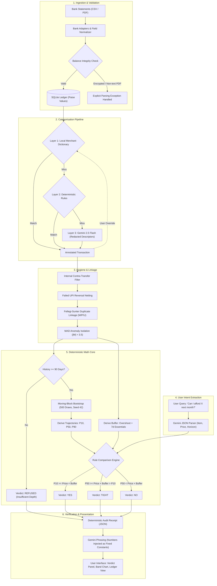

# 💰 Money Matters

> **Transparent, Verifiable & Explainable Personal Finance Affordability Engine**  
> Parses bank statement exports (CSV and PDF) across multiple accounts and answers with mathematical rigor: **"Can I afford X next month?"**

---

All multi-account merging, deduplication, anomaly handling, forecast calculations, and safety buffer derivations run in deterministic, unit-tested code. The language model operates strictly as an inbox and parser, with zero arithmetic capability.

---

## 💡 System Architecture: The PAL Pattern

Most financial tools leave multi-step calculations to an LLM, leading to arithmetic collapse on composite logic. **Money Matters** adopts the **Program-Aided Language (PAL)** separation of concerns:

- **Language Model (Gemini 2.5 Flash, $T=0$, JSON Mode):** Handles natural language input, messy merchant narration parsing into typed descriptors, and natural-language phrasing of deterministic outputs.
- **Deterministic Math Engine:** Pure functions handling integer-paise arithmetic, moving-block bootstrap forecasting, MAD-based outlier isolation, and safety buffer calculation.

> **Engineering Principle:** The LLM is the interface, not the calculator. The LLM understands; the code proves.

---

## ⚙️ Core Pipeline & Workflow

### 1. Ingestion & Multi-Account Parsing
* Ingests multiple bank CSV exports alongside PDF statement tables.
* Normalises dates to ISO 8601, cleans whitespace, maps debits and credits, and validates against running ledger balances.
* All monetary values are processed and stored as **integer paise** to prevent IEEE 754 floating-point drift.
* Flags password-protected and scanned/raster PDFs gracefully instead of attempting unreliable OCR parsing.

### 2. Three-Layer Categorisation Funnel
1. **Layer 1 (Local Alias Dictionary):** High-speed deterministic matches for 120+ standard Indian merchants (Blinkit, Swiggy, Zomato, DMart, regular utility/rent tags).
2. **Layer 2 (Deterministic Rule Patterns):** Regex and pattern classifiers for UPI/P2A transfers, ATM cash withdrawals, EMI tags, bank charges, and GST.
3. **Layer 3 (LLM Structured Classifier):** Gemini 2.5 Flash processes unmapped merchant descriptors using strict JSON schemas. Only redacted descriptors and amount tiers are sent; account numbers and user identifiers are stripped.
* User-submitted corrections propagate immediately to the alias lookup table for persistent recall.

### 3. Ledger Sanitisation & Hygiene
* **Fellegi-Sunter Record Linkage:** Partitions potential duplicates into Match ($M$), Possible Match ($P$), and Unmatch ($U$). $P$-class records are flagged in the UI for user review and are never silently removed.
* **Self-Account Transfer Exclusion:** Matches corresponding outflows and inflows across tracked accounts within 24–48 hours, eliminating double-counting of income or operational spends.
* **Failed UPI & Reversal Netting:** Auto-nets failed UPI transactions against corresponding bank reversals within 7 days to zero, preventing expense inflation.
* **Outlier Mitigation via MAD:** Applies Median Absolute Deviation ($|M_i| > 3.5$) with small-sample guards to isolate one-off spikes (e.g., medical emergencies, lump-sum bonuses) from recurring baseline medians.

### 4. Moving-Block Bootstrap Forecast
* Non-parametric simulation using contiguous 30-day blocks sampled across the user's historical daily net cash flows (credits minus debits).
* Executes 500 draws (`seed=42`) to compute non-parametric percentile paths:
  * **P10 (Conservative / Worst-Case)**
  * **P50 (Median)**
  * **P90 (Optimistic)**
* **Abstention Guarantee:** If statement history spans less than 90 days, the engine refuses evaluation (`REFUSED`) rather than projecting on sparse data.

### 5. Verdict & Transparent Receipt Generation
* Computes an adaptive safety buffer:

  $$\text{Safety Buffer} = \text{Worst-Month Variable Overshoot} + (7 \times \text{Median Daily Essential Spend})$$

* Assigns one of four mutually exclusive verdict states based on pure arithmetic:
  * **YES:** $P_{10} \ge \text{Target Price} + \text{Buffer}$
  * **TIGHT:** $P_{50} \ge \text{Target Price} + \text{Buffer}$, but $P_{10} < \text{Target Price} + \text{Buffer}$
  * **NO:** $P_{50} < \text{Target Price} + \text{Buffer}$
  * **REFUSED:** Statement history $< 3$ months
* Generates a full audit receipt detailing input parameters, data ranges, exclusion counts, buffer breakdown, and raw calculations.

---

## 📊 End-to-End Execution Flow



---

## 🛠️ Tech Stack & Setup

### Tech Stack
- **Frontend / Framework:** React 19, TypeScript, Vite, Tailwind CSS
- **Icons & Animations:** Lucide React, Motion
- **AI / LLM Integration:** Google GenAI SDK (`@google/genai`) - Gemini 2.5 Flash
- **Architecture:** Program-Aided Language (PAL) with Deterministic Math Engine

### Getting Started

1. **Clone the repository:**
   ```bash
   git clone https://github.com/Deepak0205p/ISTE-Version-Beta---23.git
   cd ISTE-Version-Beta---23
   ```

2. **Install dependencies:**
   ```bash
   npm install
   ```

3. **Configure Environment Variables:**
   Copy `.env.example` to `.env` and configure your API keys:
   ```bash
   cp .env.example .env
   ```

4. **Run the Development Server:**
   ```bash
   npm run dev
   ```
